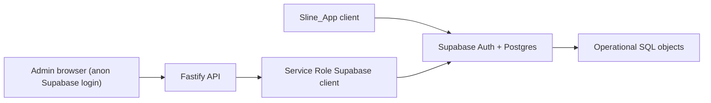

# Dashboard Project Context

## Scope And Relationship

- [Missing repo evidence] `Dashboard is a continuation of Sline_App.` This statement is required for the new ChatGPT Project, but no file in either repo states it verbatim. Search future program-level docs in `/Users/eros/Dev/Eros_Projects/SlineDashbord/Docs`, `/Users/eros/Dev/Eros_Projects/SlineDashbord/README*`, and `/Users/eros/Dev/Eros_Projects/Sline/sline_app/README*` with `rg -n "continuation|admin dashboard|backoffice|operations"`.
- [Verified in dashboard code] The dashboard is already structured as a monorepo with `apps/admin-ui`, `apps/api`, `packages/shared`, and `legacy-source`. Refs: `/Users/eros/Dev/Eros_Projects/SlineDashbord/package.json`, `/Users/eros/Dev/Eros_Projects/SlineDashbord/apps/admin-ui/package.json`, `/Users/eros/Dev/Eros_Projects/SlineDashbord/apps/api/package.json`, `/Users/eros/Dev/Eros_Projects/SlineDashbord/packages/shared/package.json`, `/Users/eros/Dev/Eros_Projects/SlineDashbord/legacy-source`.
- [Verified in app code] The mobile app is the live operational client for the same Supabase-backed system because it directly authenticates with Supabase and reads or mutates domain objects the dashboard also targets, including `profiles`, `tasks`, `conversations`, `messages`, `direct_offers`, `work_logs`, and ledger-related RPCs. Refs: `/Users/eros/Dev/Eros_Projects/Sline/sline_app/lib/features/auth/data/auth_repository.dart`, `/Users/eros/Dev/Eros_Projects/Sline/sline_app/lib/core/services/supabase_config.dart`, `/Users/eros/Dev/Eros_Projects/Sline/sline_app/lib/features/chat/services/message_service.dart`, `/Users/eros/Dev/Eros_Projects/Sline/sline_app/lib/features/direct_offers/services/direct_offers_service.dart`, `/Users/eros/Dev/Eros_Projects/Sline/sline_app/lib/features/management/services/work_log_service.dart`, `/Users/eros/Dev/Eros_Projects/Sline/sline_app/lib/features/wallet/services/ledger_service.dart`.
- [Verified in dashboard code] The admin backend is a Fastify REST API and the admin frontend is a Vite SPA using TanStack Router and TanStack Query. Refs: `/Users/eros/Dev/Eros_Projects/SlineDashbord/apps/api/src/index.ts`, `/Users/eros/Dev/Eros_Projects/SlineDashbord/apps/admin-ui/package.json`, `/Users/eros/Dev/Eros_Projects/SlineDashbord/apps/admin-ui/src/App.tsx`.

## Trust Boundaries

- [Verified in app code] The app browser or mobile client uses an anon-key Supabase SDK session and calls Supabase directly for end-user flows. Refs: `/Users/eros/Dev/Eros_Projects/Sline/sline_app/lib/core/services/supabase_config.dart`, `/Users/eros/Dev/Eros_Projects/Sline/sline_app/lib/features/auth/data/auth_repository.dart`.
- [Verified in dashboard code] The admin browser uses a Supabase anon client for login, then exchanges the authenticated context with the Fastify API over cookie-backed requests. Refs: `/Users/eros/Dev/Eros_Projects/SlineDashbord/apps/admin-ui/src/lib/supabase.ts`, `/Users/eros/Dev/Eros_Projects/SlineDashbord/apps/admin-ui/src/routes/Login.tsx`, `/Users/eros/Dev/Eros_Projects/SlineDashbord/apps/admin-ui/src/lib/api.ts`, `/Users/eros/Dev/Eros_Projects/SlineDashbord/apps/api/src/routes/auth.ts`.
- [Verified in dashboard code] The Fastify API uses `SUPABASE_SERVICE_ROLE_KEY` server-side for privileged operations and is therefore the trust boundary for admin mutations. Refs: `/Users/eros/Dev/Eros_Projects/SlineDashbord/apps/api/src/auth.ts`, `/Users/eros/Dev/Eros_Projects/SlineDashbord/apps/api/src/audit.ts`, `/Users/eros/Dev/Eros_Projects/SlineDashbord/apps/api/src/routes/users.ts`, `/Users/eros/Dev/Eros_Projects/SlineDashbord/apps/api/src/routes/tasks.ts`, `/Users/eros/Dev/Eros_Projects/SlineDashbord/apps/api/src/routes/finance.ts`, `/Users/eros/Dev/Eros_Projects/SlineDashbord/apps/api/src/routes/disputes.ts`, `/Users/eros/Dev/Eros_Projects/SlineDashbord/apps/api/src/routes/team.ts`.
- [Verified in SQL] The canonical operational store is Supabase Postgres with RLS-protected finance and audit objects including `public.accounts`, `public.journal_entries`, `public.ledger_lines`, `public.audit_logs`, and `public.withdrawal_requests`. Refs: SQL objects `public.accounts`, `public.journal_entries`, `public.ledger_lines`, `public.audit_logs`, `public.withdrawal_requests` in `/Users/eros/Dev/Eros_Projects/Sline/sline_app/supabase/migrations/20260225_create_ledger_core_schema.sql` and policies in `/Users/eros/Dev/Eros_Projects/Sline/sline_app/supabase/migrations/20260225_create_ledger_rls_policies.sql`.

## Session Models

- [Verified in app code] App session model: direct Supabase auth session through `Supabase.instance.client.auth.signInWithPassword(...)`, with current-user resolution from `Supabase.instance.client.auth.currentUser`. Refs: `/Users/eros/Dev/Eros_Projects/Sline/sline_app/lib/features/auth/data/auth_repository.dart`, `/Users/eros/Dev/Eros_Projects/Sline/sline_app/lib/main.dart`.
- [Verified in dashboard code] Admin session model: browser Supabase anon login followed by Fastify cookie session exchange is already the implemented path because the UI posts to `POST /api/v1/auth/session`, the API sets `sb_session`, and authenticated requests reuse the cookie. Refs: endpoint path `POST /api/v1/auth/session` in `/Users/eros/Dev/Eros_Projects/SlineDashbord/apps/api/src/routes/auth.ts`; `/Users/eros/Dev/Eros_Projects/SlineDashbord/apps/admin-ui/src/routes/Login.tsx`; `/Users/eros/Dev/Eros_Projects/SlineDashbord/apps/admin-ui/src/lib/api.ts`.
- [Verified in dashboard code] Admin role derivation currently depends on the `admin_users` table during token verification. Refs: SQL object name `admin_users` in `/Users/eros/Dev/Eros_Projects/SlineDashbord/apps/api/src/auth.ts`.
- [Missing repo evidence] There is no verified app SQL migration creating `public.admin_users`, so the dashboard’s current role-resolution dependency is not grounded in `Sline_App` migrations. Search `/Users/eros/Dev/Eros_Projects/Sline/sline_app/supabase/migrations` with `rg -n "admin_users"`.

## Security Invariants

- [Verified in dashboard code] Service Role must stay out of the browser bundle; the browser code only references `VITE_SUPABASE_URL` and `VITE_SUPABASE_ANON_KEY`, while service-role usage is limited to `apps/api`. Refs: `/Users/eros/Dev/Eros_Projects/SlineDashbord/apps/admin-ui/src/lib/supabase.ts`, `/Users/eros/Dev/Eros_Projects/SlineDashbord/apps/api/src/auth.ts`, `/Users/eros/Dev/Eros_Projects/SlineDashbord/apps/api/src/routes/*.ts`.
- [Verified in dashboard code] RBAC is enforced server-side today through `requireAdminRole(...)` on Fastify routes. Refs: `/Users/eros/Dev/Eros_Projects/SlineDashbord/apps/api/src/middleware/rbac.ts`, `/Users/eros/Dev/Eros_Projects/SlineDashbord/apps/api/src/routes/users.ts`, `/Users/eros/Dev/Eros_Projects/SlineDashbord/apps/api/src/routes/finance.ts`, `/Users/eros/Dev/Eros_Projects/SlineDashbord/apps/api/src/routes/disputes.ts`, `/Users/eros/Dev/Eros_Projects/SlineDashbord/apps/api/src/routes/tasks.ts`, `/Users/eros/Dev/Eros_Projects/SlineDashbord/apps/api/src/routes/team.ts`.
- [Verified in SQL] `audit_logs` is the canonical audited event store in the app repo because `public.process_payment_event_ledger(...)` inserts finance actions into `public.audit_logs` and app RLS policies are defined for `public.audit_logs`. Refs: SQL object `public.audit_logs` and function `public.process_payment_event_ledger(...)` in `/Users/eros/Dev/Eros_Projects/Sline/sline_app/supabase/migrations/20260225_create_ledger_core_schema.sql`, `/Users/eros/Dev/Eros_Projects/Sline/sline_app/supabase/migrations/20260225_create_process_payment_event_ledger_rpc.sql`, `/Users/eros/Dev/Eros_Projects/Sline/sline_app/supabase/migrations/20260304_direct_offer_accept_then_pay.sql`, `/Users/eros/Dev/Eros_Projects/Sline/sline_app/supabase/migrations/20260225_create_ledger_rls_policies.sql`.
- [Verified in dashboard code] `admin_logs` is legacy drift, not a safe canonical source, because the dashboard still writes and reads `admin_logs` in `withAudit(...)` and task activity while other dashboard flows and the app SQL rely on `audit_logs`. Refs: SQL object name `admin_logs` in `/Users/eros/Dev/Eros_Projects/SlineDashbord/apps/api/src/audit.ts`, `/Users/eros/Dev/Eros_Projects/SlineDashbord/apps/api/src/routes/tasks.ts`; SQL object name `audit_logs` in `/Users/eros/Dev/Eros_Projects/SlineDashbord/apps/api/src/routes/dashboard.ts`, `/Users/eros/Dev/Eros_Projects/SlineDashbord/apps/api/src/routes/team.ts`, `/Users/eros/Dev/Eros_Projects/SlineDashbord/apps/admin-ui/src/features/logs/services/log_actions.ts`.
- [Missing repo evidence] Case-gated chat viewing is not implemented in the current dashboard or app SQL migrations as an admin access-control model. Search `/Users/eros/Dev/Eros_Projects/SlineDashbord` and `/Users/eros/Dev/Eros_Projects/Sline/sline_app` with `rg -n "case.*chat|chat access|investigation case|grant_case|redact_message"`.
- [Missing repo evidence] PII masking by default plus explicit reveal logs is only partially evidenced by finance metadata masking, not as a platform-wide rule. Search `/Users/eros/Dev/Eros_Projects/SlineDashbord/apps/admin-ui/src` with `rg -n "mask|reveal|sensitive|PII"`.
- [Verified in SQL] Idempotency exists for ledger-affecting payment events because `public.process_payment_event_ledger(...)` accepts `p_idempotency_key` and writes to `public.journal_entries.idempotency_key`. Refs: SQL object `public.process_payment_event_ledger(...)` and table `public.journal_entries` in `/Users/eros/Dev/Eros_Projects/Sline/sline_app/supabase/migrations/20260225_create_process_payment_event_ledger_rpc.sql`, `/Users/eros/Dev/Eros_Projects/Sline/sline_app/supabase/migrations/20260304_direct_offer_accept_then_pay.sql`, `/Users/eros/Dev/Eros_Projects/Sline/sline_app/supabase/migrations/20260225_create_ledger_core_schema.sql`.
- [Missing repo evidence] `Idempotency-Key` as an HTTP requirement for dangerous admin mutations is not enforced in current Fastify routes. Search `/Users/eros/Dev/Eros_Projects/SlineDashbord/apps/api/src` with `rg -n "Idempotency|idempotency"`.
- [Missing repo evidence] Dual approval for dangerous finance actions is not implemented in current API routes or app SQL migrations. Search `/Users/eros/Dev/Eros_Projects/SlineDashbord` and `/Users/eros/Dev/Eros_Projects/Sline/sline_app/supabase/migrations` with `rg -n "dual approval|second approver|approved_by_2|requires_approval"`.

## Required RBAC Roles

- [Verified in dashboard code] Current dashboard role vocabulary is `support`, `moderator`, `admin`, and `super_admin`. Refs: Zod schema files `/Users/eros/Dev/Eros_Projects/SlineDashbord/packages/shared/src/schemas/users.ts`, `/Users/eros/Dev/Eros_Projects/SlineDashbord/packages/shared/src/schemas/tasks.ts`, `/Users/eros/Dev/Eros_Projects/SlineDashbord/packages/shared/src/schemas/disputes.ts`, `/Users/eros/Dev/Eros_Projects/SlineDashbord/packages/shared/src/schemas/finance.ts`, `/Users/eros/Dev/Eros_Projects/SlineDashbord/packages/shared/src/schemas/team.ts`, `/Users/eros/Dev/Eros_Projects/SlineDashbord/packages/shared/src/schemas/logs.ts`.
- [Verified in dashboard code] Read access is broader than write access in current contracts, for example `USERS_READ_ROLES` allows `support`, `moderator`, `admin`, `super_admin`, while `USERS_WRITE_ROLES` allows only `admin`, `super_admin`. Refs: Zod schema names `USERS_READ_ROLES`, `USERS_WRITE_ROLES` in `/Users/eros/Dev/Eros_Projects/SlineDashbord/packages/shared/src/schemas/users.ts`.
- [Verified in dashboard code] Team-management writes are restricted to `super_admin` through `TEAM_WRITE_ROLES`. Refs: Zod schema name `TEAM_WRITE_ROLES` in `/Users/eros/Dev/Eros_Projects/SlineDashbord/packages/shared/src/schemas/team.ts`.
- [Missing repo evidence] A dedicated investigation role, finance dual-approval role, or case manager role is not defined in shared contracts or app SQL. Search `/Users/eros/Dev/Eros_Projects/SlineDashbord/packages/shared/src/schemas` and `/Users/eros/Dev/Eros_Projects/Sline/sline_app/supabase/migrations` with `rg -n "investigation|case_manager|finance_reviewer|compliance"`.

## Canonical Data Model Index

- [Verified in SQL] `public.accounts`, `public.journal_entries`, `public.ledger_lines`, `public.withdrawal_requests`, `public.booking_payment_audits`, `public.audit_logs`, `public.vw_wallet_balances_user`, `public.vw_wallet_activity_user`, `public.vw_financial_metrics_realtime`, and `public.vw_financial_metrics_period` are required for finance and audit operations. Refs: SQL objects in `/Users/eros/Dev/Eros_Projects/Sline/sline_app/supabase/migrations/20260225_create_ledger_core_schema.sql`, `/Users/eros/Dev/Eros_Projects/Sline/sline_app/supabase/migrations/20260225_create_wallet_views.sql`.
- [Verified in SQL] `public.direct_offers`, `public.process_payment_event_ledger(...)`, `public.rpc_create_booking_draft_validated(...)`, and `public.rpc_finalize_booking_refund(...)` are required for booking or offer-linked payment timelines. Refs: SQL objects in `/Users/eros/Dev/Eros_Projects/Sline/sline_app/supabase/migrations/20260303_direct_offers_table_rls_trigger.sql`, `/Users/eros/Dev/Eros_Projects/Sline/sline_app/supabase/migrations/20260304_direct_offer_accept_then_pay.sql`, `/Users/eros/Dev/Eros_Projects/Sline/sline_app/supabase/migrations/20260228_bookin_server_authority.sql`.
- [Verified in app code] `conversations`, `messages`, `work_logs`, and the RPC `start_task_conversation_v1` are part of the operational graph the dashboard must be able to inspect for investigations. Refs: SQL object names as queried from `/Users/eros/Dev/Eros_Projects/Sline/sline_app/lib/features/chat/services/message_service.dart`, `/Users/eros/Dev/Eros_Projects/Sline/sline_app/lib/features/management/services/work_log_service.dart`.
- [Verified in SQL] `public.archive_conversation_v1(uuid)`, `public.can_access_chat_attachment(text, uuid)`, and `public.is_work_log_participant(uuid, text, uuid)` are important chat and work-access control primitives already present in app SQL. Refs: SQL object names in `/Users/eros/Dev/Eros_Projects/Sline/sline_app/supabase/migrations/20260302_chat_archive_rpc_and_storage_helper.sql`.
- [Missing repo evidence] `public.admin_users`, `public.vw_admin_journal_ledger`, `public.vw_analytics_monthly_revenue`, and `public.vw_analytics_monthly_user_growth` are required by dashboard code but not verified in app SQL migrations. Search `/Users/eros/Dev/Eros_Projects/Sline/sline_app/supabase/migrations` with `rg -n "admin_users|vw_admin_journal_ledger|vw_analytics_monthly_revenue|vw_analytics_monthly_user_growth"`.
