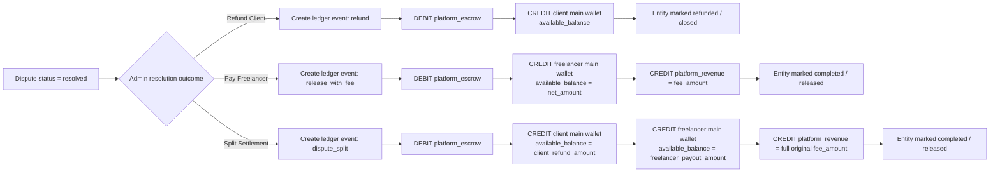
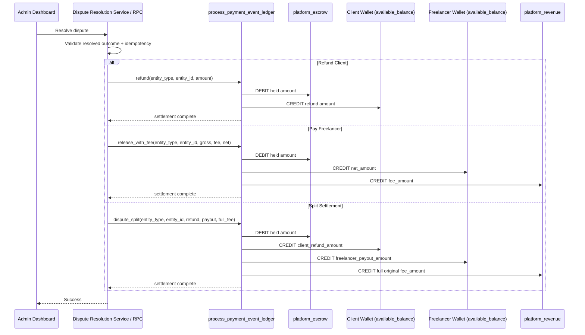

# 25 — Dispute Resolution Wallet Settlement

---

## Diagram Title + Version

| Field | Value |
|-------|--------|
| **Diagram name (exact)** | 25_dispute-resolution-wallet-settlement |
| **Version** | v2 — 2026-03-14 |
| **Owner/author** | SLine architecture / payments flow |
| **References** | 14_dispute-lifecycle, 05_booking-lifecycle, 19_direct-offers-work-contract, 21_Wallet_System_Escrow_Available_balances, 22_Dynamic_Platform_Fee, Docs/features/disputes.md |

---

## Purpose

- **What this diagram is showing:** The money settlement path after a dispute is resolved by admin, with three outcomes in scope: `refund client`, `pay freelancer`, or `split settlement`.
- **What problem it solves:** It clarifies where money lands after dispute resolution: client refund goes to the client's main wallet (`available_balance`), freelancer payout goes to the freelancer's main wallet (`available_balance`), and when payout happens or a split is used the platform fee is kept in `platform_revenue`.

---

## Scope

- **Included:** Dispute resolved outcome, escrow debit, client refund, freelancer payout, split settlement, platform fee retention, wallet destination, idempotency, settlement targets (`booking`, `task_request`, `direct_offer`), admin UI split preview behaviour.
- **Excluded:** Withdrawal flow, off-platform bank/card refunds, dispute evidence/chat lifecycle, notification delivery.
- **Assumptions:** Money is still in `platform_escrow`; settlement is executed only by admin/server-side RPC; wallet "main wallet" means user `available_balance`; task/tender disputes settle against `task_request`, not the `tasks` row itself.

---

## Core Rules

- Settlement target can be a **booking**, **task_request** (tender/task-paid flow), or **direct_offer**.
- If admin resolves dispute as **Refund Client**, money leaves `platform_escrow` and is credited to the **client main wallet**.
- If admin resolves dispute as **Pay Freelancer**, money leaves `platform_escrow`, the **platform fee is kept** in `platform_revenue`, and the **net amount** is credited to the **freelancer main wallet**.
- If admin resolves dispute as **Split Settlement**, money leaves `platform_escrow`, the **full original platform fee is kept** in `platform_revenue`, part is credited to the **client main wallet**, and the remaining net payout is credited to the **freelancer main wallet**.
- Settlement must be idempotent. The same dispute resolution must not create duplicate ledger entries.
- No client or freelancer app call can bypass the admin/server settlement path.
- DB-side dispute authorization is aligned to dashboard staff roles through `admin_users` via `can_manage_disputes(...)`.
- Split settlement UI is now auto-calculated from held amount + fee rate so the operator does not manually derive the payout side.

---

## Wallet Mapping

| Outcome | Escrow effect | User wallet destination | Platform effect |
|---------|---------------|-------------------------|-----------------|
| **Refund Client** | DEBIT `platform_escrow` | CREDIT client `available_balance` | No fee kept from payout path |
| **Pay Freelancer** | DEBIT `platform_escrow` | CREDIT freelancer `available_balance` with `net_amount` | CREDIT `platform_revenue` with `fee_amount` |
| **Split Settlement** | DEBIT `platform_escrow` | CREDIT client `available_balance` with `client_refund_amount` and CREDIT freelancer `available_balance` with `freelancer_payout_amount` | CREDIT `platform_revenue` with full original `fee_amount` |

---

## Settlement Diagram

---

## Sequence Diagram

---

## Human Story

1. A dispute reaches `resolved`.
2. Admin chooses one final financial outcome.
3. If the choice is **Refund Client**, the money goes back into the client's main wallet, not to freelancer.
4. If the choice is **Pay Freelancer**, the money goes into the freelancer's main wallet, and the platform fee stays in platform revenue.
5. If the choice is **Split Settlement**, the admin enters or presets the client refund amount, the UI automatically calculates freelancer payout after fee retention, and the platform still keeps the full original fee.
6. For tender/task-paid work, the money source is the held `task_request`, not the `task` row.
7. After settlement, the related booking / task_request / direct offer payment state is closed and should not be settled again.

---

## Source Of Truth

- **Dispute lifecycle:** `14_dispute-lifecycle.md`
- **Booking disputed resolution:** `05_booking-lifecycle.md`
- **Wallet balances and escrow:** `21_Wallet_System_Escrow_Available_balances.md`
- **Platform fee retention:** `22_Dynamic_Platform_Fee.md`
- **Direct offer release/refund path:** `19_direct-offers-work-contract.md`
- **Admin feature doc:** `Docs/features/disputes.md`

---

## Final Rule

- **Client refund after dispute:** deposit into client `available_balance`.
- **Freelancer payout after dispute:** deposit net into freelancer `available_balance`.
- **Platform fee on payout path:** keep in `platform_revenue`.
- **Platform fee on split path:** keep the full original `fee_amount` in `platform_revenue`.
