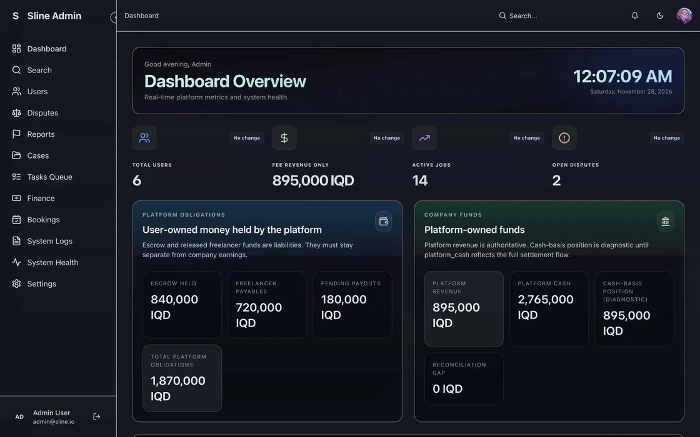
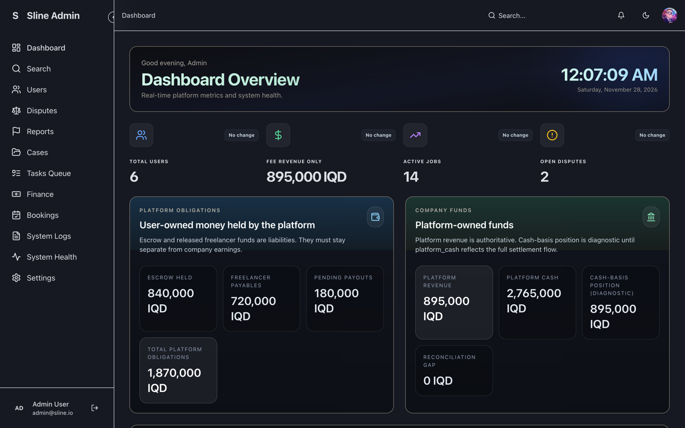
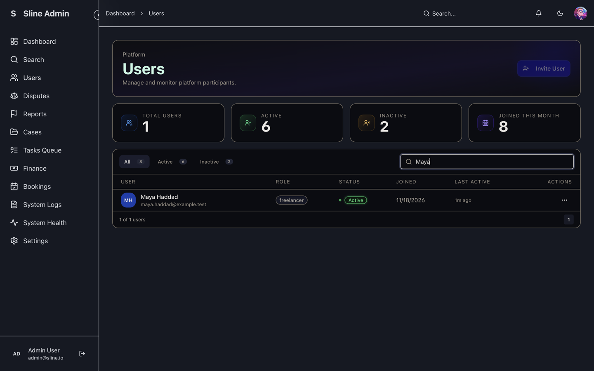
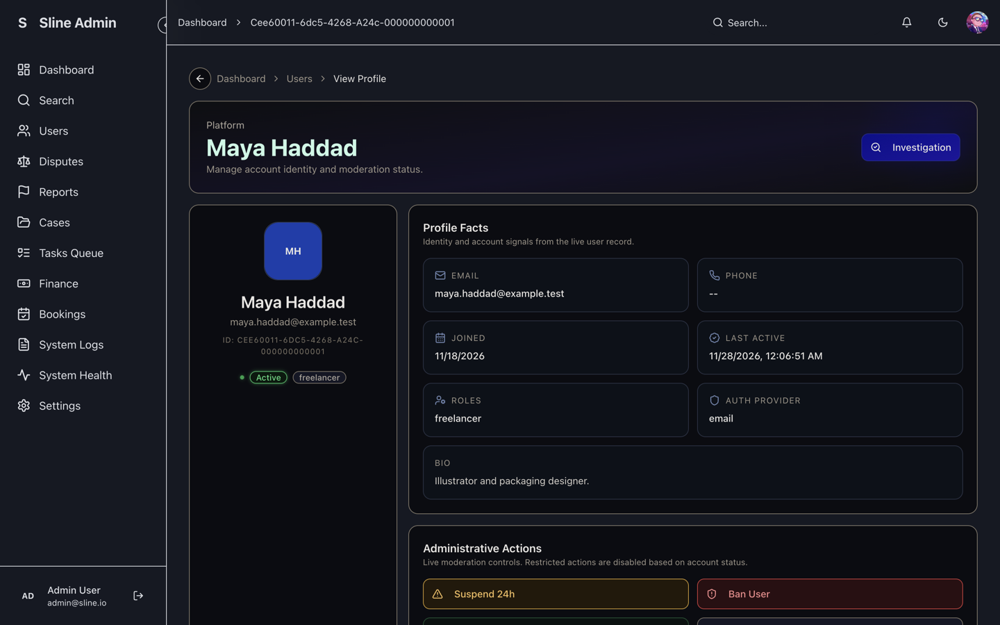

# SLine Dashboard

SLine Dashboard is the internal admin console for the SLine freelance marketplace. Staff use it to find accounts, review bookings and disputes, handle moderation cases, and monitor finance and system activity.

## Find and review an account

Start on **Dashboard Overview**. Open **Users**, search by a name, email, or ID, then choose **View Profile** from the matching row’s actions. The profile shows the account’s role and status and gives authorized staff access to its investigation view.



The recording shows the running React app with fictional accounts and metrics from a local mock API.

<details>
<summary>Still screenshots</summary>

**Dashboard overview.** Review user activity, open disputes, and financial totals. The overview displays user funds separately from company revenue.



**User search.** Filter the table by name or account status to find the right record.



**User profile.** Review identity, role, and moderation status before deciding whether to investigate further.



</details>

## Other staff workflows

- **Operations.** Review tasks, bookings, disputes, reports, and cases from their queues.
- **Finance.** Review transactions, withdrawals, approvals, and the audit trail.
- **System health.** Inspect service status and system logs when following up on an incident.

## Run a development copy

Use Node.js **20**, the version in CI, and npm. The root package records npm **11.6.3**. Use an authorized Supabase development branch with the SLine schema and an active Dashboard account. The frontend signs in with Supabase Auth. The API checks the account’s role against `admin_users`.

From the repository root:

```sh
npm ci
npm run build -w @sline/shared
```

Create an API environment file outside the repository, for example at `~/.config/sline-dashboard/api.env`. Set its permissions to `600` and use your development project values.

```dotenv
SUPABASE_URL=https://your-development-project.supabase.co
SUPABASE_ANON_KEY=replace-with-your-development-client-key
SUPABASE_SERVICE_ROLE_KEY=replace-with-your-development-server-key
PORT=3010
ALLOWED_ORIGINS=http://localhost:3000
NODE_ENV=development
```

Create `apps/admin-ui/.env.development.local` with the URL and client key for the same development project. The service-role key belongs in the API environment file.

```dotenv
VITE_SUPABASE_URL=https://your-development-project.supabase.co
VITE_SUPABASE_ANON_KEY=replace-with-your-development-client-key
VITE_API_BASE_URL=http://localhost:3010
```

Start the API and the web app from the repository root in separate terminals.

```sh
DOTENV_CONFIG_PATH="$HOME/.config/sline-dashboard/api.env" npm run dev:api
```

```sh
npm run dev:admin
```

Open `http://localhost:3000` and sign in. A successful login opens **Dashboard Overview**. To check the API on its own, run `curl --fail http://localhost:3010/health` and look for `"status":"ok"`.

## Repository layout

| Workspace | Responsibility |
| --- | --- |
| [`apps/admin-ui`](apps/admin-ui/package.json) | React and Vite interface with TanStack Router and Query |
| [`apps/api`](apps/api/package.json) | Fastify endpoints, session cookies, role checks, and Supabase access |
| [`packages/shared`](packages/shared/package.json) | Shared TypeScript types and Zod schemas |

The Dashboard and [SLine mobile app](https://github.com/faroqomar/SlineProject) share a Supabase backend. See the [security manual](Docs/ADMIN_SECURITY_MANUAL.md) for access rules and audit requirements.

## Development checks

```sh
npm run typecheck -w @sline/admin-ui
npm run typecheck -w @sline/api
npm run forbidden-imports -w @sline/admin-ui
npm run test -w @sline/api
```

See [CI](.github/workflows/ci.yml) for build and browser checks.

Private source and captures for authorized readers. The project owner’s agreements govern disclosure.
